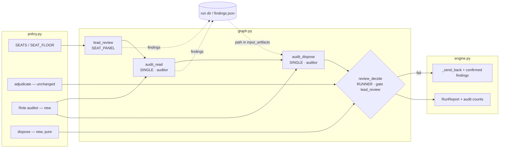
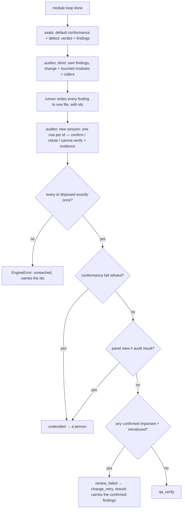

# CHG-20261028-01 — seats find, an independent auditor re-reads and disposes, the runner decides

- Project: ai-sdlc-runner
- Branch: local/chg-review-audit (from main @ 587ebcc)
- Date: 2026-10-28 (UTC+0)
- Type: feature (runner): the whole-change review (`lead_review`) gains a second stage. The seats
  report findings; an auditor on a different backend re-reads the change against them and answers
  one disposition per finding; the runner adjudicates the dispositions. Only confirmed findings
  travel to the rework. By default the panel opens only the necessary seats (`conformance`,
  `defect`); the auditor is the third view the floor asks for, and more seats open only when the
  user asks.
- Proposed by: the user, 2026-10-28 (「如果autopilot或runner簡化部分審議席並且這些審議席處理完提供重點後再由
  獨立模型依據這些重點重新讀整份專案再次審議 最終產出的結果才提交處理修正呢?」, then 「寫CHG並commit
  並提供理由」); Q1 answered 2026-10-28 (「減少不必要的席位 預設是最少的必要席位除非使用者需要才增加」)
- Risk: **medium**. It changes how the one node that decides whether a whole change passes review
  reaches its branch (FR-9, FR-10), adds a role, and adds two asking nodes to `graph.NODES`. It
  touches none of the six permanent halts, no gate's verdict table, and no work-order field. It
  is rolled back by reverting it; run records written under it stay readable, because they only
  gain entries.
- Autonomy: medium — confirm gate before building; the open questions below are the user's.
- Related: CHG-20261005-02 (the fifteen dimension seats), CHG-20261016-01 (seat role and spec),
  CHG-20260902-21 (the rework that carried no reasons), CHG-20261021-01 (the run report, which
  this feeds), FR-6 / FR-7 / FR-8 / FR-9 / FR-10 / FR-14 / FR-24, KN-5, KN-7, KN-8.

## Why

Five reasons. Each one names what it rests on.

1. **The rework is still told who objected and not what they found.** `engine._send_back` builds
   its `appendix` from `{"voice": who, "verdict": v}` (engine.py, `_send_back`). The seat's reason
   never reaches `fix_pass` or the next lap of the module loop. CHG-20260902-21 fixed the rework
   receiving nothing. It still receives a list of seat names. A rework that knows `defect` failed,
   but not on which input, guesses. Guessing is how a change spends the one `change_retry` it has.
2. **A seat's objection goes straight to the builder, unchecked.** Every `fail` that is not a tie
   becomes rework, whether or not it is real. The Claude Code team measured the cost of that
   (claude.dev, *How the Claude Code team does code review*, 2026-10-15). Their parallel finders
   are followed by verifiers that vote on each finding, and only the survivors are posted. Their
   reasons: a nit costs a person seconds and costs an agent author a commit plus another review
   round, and in one case agent author and agent reviewer looped more than fifty times overnight.
   This runner bounds the loop (one fix pass, one `change_retry`). The bound limits the damage of
   a false finding. It does not stop the false finding from spending the budget.
3. **A seat reads the diff; nobody reads the code around it.** Each seat answers its own question
   about the change. A caller three files away that the change breaks is outside every seat's
   question unless some seat happens to look. A reader whose job is "re-read the change and what
   it touches, guided by what the seats found" covers that ground on purpose.
4. **The fifteen dimension seats are expensive at full strength.** CHG-20261005-02 opened up to
   twelve prefix seats plus three opt-in ones, each its own session (FR-6, KN-7). If seats only
   have to *find*, and something else checks what they found, a seat can run on a cheaper model
   without the decision getting cheaper. The expensive reading happens once.
5. **It is how the specialist-seat question gets answered without a new voting rule.** The open
   design question was whether two same-group specialist seats count as one vote or two (the
   2:2 undecided semantics change otherwise). Here findings are not votes. Two security seats are
   two sources of findings, and the auditor disposes of each finding once. The arithmetic stays
   in `policy.adjudicate`, untouched for the seats it already counts.

6. **Seats that nobody asked for cost every review and decide nothing extra** (the user,
   2026-10-28). Each seat is a session, and with the auditor checking every finding, a third or
   fourth seat by default adds findings to dispose of rather than a view that is otherwise
   missing. The default becomes the seats without which the review cannot work: the veto
   (`conformance`) and the seat whose question produces triggers (`defect`). The user adds the
   rest when a change needs them.

What this does **not** buy: the auditor is one model reading once. It is a single point where
findings can be dropped. Most of the rules below exist to stop that point from deciding alone.

## What changes

1. **Seats report findings as well as a verdict.** The seat reply schema gains `findings`: a list
   of `{id, file, line, claim, trigger, severity, origin}`.
   - **`file` and `line` are required (Q2).** A finding with no location is refused at parse time:
     it cannot be passed on, and it cannot be disposed. The location is what lets the auditor go to
     the code instead of reading the seat's prose about it. Every disposition (step 4) carries a
     location too.
   - `trigger` is the concrete input and the wrong result it produces. It is the `defect` seat's
     existing standard, written into the schema so every seat is held to it. A finding without
     one may still be reported, but it can never be `important`.
   - `severity` is `important` or `nit`. `origin` is `introduced` (this change caused it) or
     `pre-existing`.
   - The seat keeps its verdict and its question. `policy.adjudicate` still counts the seat
     verdicts, and the conformance veto still applies (FR-10). That result is recorded as the
     panel's view and is one input to step 5. It no longer routes on its own.
   - What a seat reads does not change. A seat may still be routed to a cheaper model through the
     existing `--seat-model` / `seat_models` (FR-14); that is the user's choice, not a default.
2. **Fewer seats by default: only the necessary ones (Q1, answered).** A new
   `policy.SEAT_DEFAULT = 2` opens `conformance` and `defect`, the first two of the opening order.
   `settings` and `--review-seats` default to it instead of `SEAT_FLOOR`. Everything else is
   opened only when the user asks for it, through `review_seats` or `review_dimensions`, exactly
   as today. That includes `risk`, the third seat that opens today.
   - **The floor keeps its meaning and changes what it counts.** `SEAT_FLOOR = 3` stays: a review
     needs at least three independent views. It now counts **seats + the auditor**, and the auditor
     counts only when its backend differs from the builder's and from every open seat's. Two seats
     plus an independent auditor meet it. One seat plus an auditor does not, and still needs
     high-risk mode (FR-13), with the same message and record.
   - **Same-backend auditor: the floor is unmet, not silently met.** With no second backend
     available, the auditor is the same model reading again. That is not a third view. The run
     then needs a third seat opened by the user, or high-risk mode, as a two-seat panel would
     today.
   - **`conformance` cannot be left out**: `vetoes_missing` is unchanged. **`defect` is the second
     necessary seat** because its question — concrete input, wrong result — is the standard every
     finding is now held to (step 1). A default panel without it has no seat whose job is to
     produce the triggers the auditor disposes of.
3. **`audit_read` — the auditor reads blind first.** A new role, `auditor`
   (`can_spawn=False, can_write=False, can_execute=True` — the seat's flags), in its own session.
   - It is given the change and its scope: the diff, the modules it touches, and their callers and
     callees. That is the reading of 「整份專案」 chosen below.
   - **What it read is recorded, and what it did not read is recorded too (Q3).** The runner
     assembles the scope as a file list and bounds it with `AUDIT_SCOPE_MAX_CHARS`. The record
     holds every file in scope, each marked `read` or `cut`, with the cap and the total. A cut
     scope is printed beside the review's outcome and appears in the run report's *Limits*. An
     audit that passed over code it never saw does not read as a full audit.
   - It is **not** given the seats' findings. It answers with findings of its own, in the same
     shape.
   - This is the anti-anchoring half. A reader handed a list reads the list.
4. **`audit_dispose` — the auditor disposes, in a new session.** The order's `input_artifacts`
   names one file the runner wrote under the run's directory: every finding from steps 1 and 3,
   each with an id. The findings are referenced by path, not inlined (KN-5).
   - The answer is one row per id: `confirm`, `refute` or `cannot-verify`, each with `evidence`
     (file and line).
   - A `refute` must carry the concrete input and the right result it produces. A refute that only
     says the finding is wrong is read as `cannot-verify`.
   - Two sessions, not one: FR-3 (one node, one kind of work) and FR-6 (a session per ask). The
     second session sees the first one's findings only as rows in that file, alongside everyone
     else's.
5. **`review_decide` — the runner adjudicates, and no model does.** A new `RUNNER` decision node,
   with the gate `lead_review` moved onto it unchanged (low/medium AUTO, high HALT, `after`). Rules,
   in order:
   1. **Every finding has exactly one disposition.** A missing row, a duplicate row, or an id
      nobody raised means the answer is unreached. The run stops with an `EngineError` naming the
      ids, the same way a seat that names no verdict does (`_adjudicate`). A dropped finding is not
      a refuted one.
   2. **The conformance veto cannot be refuted away.** A conformance `fail` that the auditor
      refutes is a disagreement, and the outcome is `undecided`. That reaches a person through the
      existing three-outcome routing. It never becomes `pass`. FR-10's "a veto seat cannot be
      outvoted" now also covers "cannot be audited out".
   3. **Confirmed `important` + `introduced` findings fail the review.** Their text — claim,
      trigger, evidence, and the seat or auditor that raised them — goes to the rework through
      `_send_back`. The `appendix` gains these findings, and stays marked "reference, not
      instruction".
   4. **The auditor's own findings need a trigger to count.** From step 3, an `important`
      `introduced` finding with a trigger counts as confirmed by its author. Without a trigger it
      is recorded and does not fail the change. No other voice checked it, so it is held to the
      bar a seat's veto-less finding is held to.
   5. **What does not fail the change is still kept.** Refuted, `cannot-verify`, `nit` and
      `pre-existing` findings are written to `RunReport` and to CHG-20261021-01's run report.
      They are not dropped. They are not sent to the rework: a rework driven by nits is the loop
      this change is meant to shorten. `pre-existing` findings are candidates for `docs/knowledge/`.
   6. **Panel view and audit disagree → `undecided`.** If the seats' `adjudicate` result and the
      result from rules 1–5 differ, nothing is waived. For example, the seats fail on a
      majority and every finding behind it is refuted. That disagreement reaches a person, and the
      person sees both.
6. **The auditor's backend should differ from the builder's and from every seat's.** When it does
   not, the run records it in `RunReport.single_model_panels`'s sibling `audit_same_backend`, and
   prints it, as FR-24 does for a one-backend panel. The auditor still runs, but it does not count
   toward the floor (step 2). Routing is the CLI's: `--audit-model COMMAND`, or
   `audit_model` in the plan, beside `seat_models` (FR-14). Nothing about it enters the order.
7. **The record carries the measurement this needs.** Per review: findings raised per source, the
   count of each disposition, rounds to pass, and the refute rate. These are counts from the
   record, made for CHG-20261021-01's report and computed by the runner. No model summarises them.

## Design diagrams

The affected area — what reads and writes what:

The flow of one review:

## Interpreted, and what it was chosen over

- **「整份專案」 is the change and what it touches, not every file.** That means the diff, the
  modules it modifies, and their direct callers and callees, with the repository as `workdir` so
  the auditor can follow anything further. It was chosen over the whole repository because a
  project larger than one context window would be read partially, with nothing saying which part.
  It is bounded by a character cap, and what the cap left out is recorded (Q3).
- **The auditor disposes; it does not judge the change.** It answers per finding, never with one
  overall verdict. An overall verdict from one model would be the "model relaying model" step the
  runner refuses elsewhere: one model's blind spot laid over every seat's. The tally stays in
  code.
- **Two auditor sessions, not one long one.** This was chosen over one session that reads blind
  and then sees the findings. Continuity is a hazard here (§6), and a session that has already
  formed a view is the reader KN-7 exists to avoid.
- **Findings go by file path, not by a new work-order field.** `input_artifacts` already exists
  and KN-5 already requires bodies by path. This keeps `WORK_ORDER_FIELDS` closed and unchanged
  (FR-8). It is an interpretation, accepted with Q2: FR-8 says an order carries "no prior answer".
  This reads that as no prior answer *of the same session*, the continuity it protects against.
  Other sessions' findings, labelled as such, are inputs. The rework already receives the seats'
  verdicts this way.
- **"Necessary" means `conformance` and `defect`.** This was chosen over `conformance` alone,
  which plus the auditor is two views, below the floor. It was also chosen over keeping today's
  three (`conformance`, `defect`, `risk`): `risk` asks what is hard to undo, and the change's risk
  grade is already decided by a model panel before the build (`adjudicate_grade`), with every
  gate indexed on it. The seat stays one step away: `review_seats 3` opens it, as it opens today.
- **The auditor counts toward `SEAT_FLOOR`, and only when independent.** This was chosen over
  lowering the floor to 2. The floor exists because "a single reviewer is exactly the single point
  of view the panel exists to avoid" (policy.py). An auditor on a different backend is a third
  point of view, so counting it keeps that reason intact. Lowering the number would discard it.
  An auditor on a seat's backend is not a third view, so it does not count.
- **The seat verdicts are kept, not replaced by findings.** Dropping them would remove the veto
  FR-10 rests on, and would make this change a rewrite of the panel rather than a stage after it.
  The cost: a seat answers twice as much.

## Open questions — the user's (confirm gate)

- **Q1. What does 「簡化部分審議席」 mean? — answered 2026-10-28:** fewer seats. The default is the
  minimum necessary seats, and more open only when the user asks (「減少不必要的席位 預設是最少的必要席位
  除非使用者需要才增加」). Written as step 2. Which two seats are "necessary", and counting the auditor
  toward the floor, are this CHG's reading of that answer (see *Interpreted*), shown at the gate.
- **Q2. FR-8's "no prior answer" — answered 2026-10-28:** findings reach the auditor by path, and
  each one carries its location (「要帶問題位置」). Written in step 1: `file` and `line` are required,
  and a finding without them is refused.
- **Q3. The auditor's reading scope — answered 2026-10-28:** it must be recorded (「需要記錄」).
  Written in step 3. Reading this as "bounded by a cap, with read and cut files recorded" is
  this CHG's interpretation, shown at the gate. The cap's value is set when task 2a is built and
  is measured against run 4 of CHG-20261019-01.
- **Q4. The auditor's own triggered findings — answered 2026-10-28:** they count directly
  (「直接算數」), as rule 5.4 is written. No second disposition session.

## Not in this change, proposed separately

- **An eval set from past failures.** Replay runs whose change was later rejected or reverted, and
  score the seats and the auditor against them. Without it, "the auditor refutes well" is a claim
  rather than a measurement. Step 7's counts are its inputs, not the eval itself.
- **Diff-only re-review on the second lap**, and **not repeating a finding already disposed**. Both
  shorten the loop further. Both depend on finding ids being stable across laps, which this
  change creates.
- **Applying the same stage to `lead_task_review` / `re_review`** (per-module review). This change
  stops at the whole-change review, where the cost of a false finding is a `change_retry`.
- **The ai-sdlc-autopilot skill's runner.** The user asked about "autopilot or runner"; this repo
  holds no skill (§2), so the skill's equivalent is a change in its own repository, written after
  this one has a measured outcome.

## Tasks

| # | Task | Done when | State |
|---|---|---|---|
| 1 | Seat reply schema gains `findings`; `trigger`-less findings can never be `important` | schema documented in docs/SCHEMAS.md; a test fails when a trigger-less `important` is accepted | [x] |
| 1a | `SEAT_DEFAULT = 2`; `settings`, `--review-seats` and `runner policy` default to it; the floor counts seats + an independent auditor | a default run opens exactly `conformance`, `defect` and the auditor; `review_seats 3` opens `risk`; one seat without high-risk mode is refused; an auditor on a seat's backend leaves a two-seat panel below the floor | [x] |
| 2a | Audit scope as a file list with `AUDIT_SCOPE_MAX_CHARS`; each file recorded `read` or `cut` | a scope over the cap records the cut files and prints them; a finding without `file`/`line` is refused | [x] |
| 2 | `Role("auditor")`, nodes `audit_read`, `audit_dispose`, `review_decide`; gate `lead_review` moved to `review_decide` | `graph.validate()` passes; a test asserts the gate is consulted at `review_decide` and nowhere else | [x] |
| 3 | `policy.dispose(...)`: pure, rules 5.1–5.6 | one test per rule; cutting rule 5.1 or 5.2 fails a named test (KN-8) | [x] |
| 4 | Findings file written under the run dir, referenced by path; `WORK_ORDER_FIELDS` unchanged | the closed-schema test still passes; a test asserts no finding text is inlined in the order | [ ] |
| 5 | `_send_back` carries confirmed findings; refuted / nit / pre-existing do not travel | the rework lap's order references the confirmed findings and none of the others | [ ] |
| 6 | `--audit-model` / `audit_model`; `audit_same_backend` recorded and printed | tests for routed, same-as-builder and same-as-a-seat | [ ] |
| 7 | Audit counts in `RunReport` (and CHG-20261021-01's report, if built first) | counts reproduced from a stand-in run's record | [ ] |
| 8 | docs: ai-guideline FR-9 / FR-10 / FR-13 rows and a new FR, ARCHITECTURE, SCHEMAS | ledger lint passes; FR rows name `policy.dispose` | [ ] |
| 9 | DIR-3 matrix review and acceptance | an ACC records it | [ ] |

## Status

In progress. Drafted on the user's request of 2026-10-28; Q1–Q4 answered the same day. **Approved
at the confirm gate 2026-10-28 04:15 (UTC+0)** (「核准」), including the two interpretations marked
above (which two seats are necessary; the auditor counting toward the floor). Built on
`local/chg-review-audit` by the DIR-3 coder (`claude-sonnet-5-5`, effort medium). Suite baseline
before building: 3224 passed, 6 skipped.
