# 實測報告：真實後端下的模組迴圈（CHG-20261019-01）

- **日期**：2026-10-19（UTC）
- **程式版本**：分支 `local/chg-loop-measure`。量測用的 Run 4 跑在 `7b834e0` 上（步驟 70）。
- **後端**：每個節點都是 `claude-sonnet-5-5`、effort `medium`，每次 ask 是一個 `claude -p` 程序。
- **範例**：`examples/weather-live`。這個範例只放人交給 runner 的東西：brief、plan、`runner.yaml`、`models.json`。頁面完全由 runner 實跑時建出，沒有範例 agent。
- **操作方式**：用 `drive.py` 透過 `runner serve` 和 console 操作 run，就像操作員在 console 上做的一樣。執行中，console 由 Chromium 定時擷取，同步推送到即時頁面。
- **截圖與紀錄**：每筆指令、每項設定、每張畫面都附有圖片和文字紀錄，放在 `steps/`。下方「操作流程」逐步列出。截圖已用 `capture.py check` 掃過，沒有任何密鑰。

## 1. 結論

**範例確實在模組迴圈裡建完十個模組。** Run 4 在 13 分 59 秒內從 `intake` 走到 `done`，共 44 次 ask，十個檔案各由一次 `engineer_build` 寫出，寫檔歸屬核對全數通過。建出的頁面用真實 Open-Meteo 能正確顯示，請求失敗時也會顯示錯誤狀態。

**模組迴圈佔工作時間 59%。** 用這個佔比算，4 個 builder 的加速上限是 **1.80 倍**，無限多個是 **2.47 倍**。這比 Task 6 用 ask 數推估的十模組上限低：ask 數推估是 2.05 倍和 3.14 倍。

**原因**：迴圈內的 ask 比較短，平均 16.6 秒；迴圈外的審查、QA、merge 比較長，平均 22.9 秒。所以用 ask 數估算會高估迴圈佔比。

**對第二步（並行建置）的建議**：在十個模組的規模，目前還不建議做，由你決定。
- 開 4 個 builder 最多把 14 分鐘縮成約 7.8 分鐘，前提是理想並行。
- 要拿到這些時間，得做 CHG-20260827-21 列出的 commit graph 合併、`last_word` 合取等工作。
- 下面第 4 節列出的 runner 修正項，多數比並行更急，也更便宜。
- 這是單次實測，數字有波動空間。如果你想用重複幾次的結果來決定，可以再跑。
- 1.80 倍是上限。十個模組並非互相獨立：brief 允許後面的模組呼叫前面模組提供的東西，所以實際加速會更低。
- 不靠並行就能省時間的地方：`engineer_selfverify` 共 10 次 ask、148.6 秒，佔整個 run 的 18%，而這次它沒有改動任何檔案。

**花費沒有量到。** 範例的指令沒有加 `--output-format json`，runner 拿不到用量，console 只顯示「not reported by this backend」。目前知道的是 ask 次數：
- Run 1：8 次
- Run 2：2 次
- Run 3：12 次
- Run 4：44 次

共 66 次。從第一次探測到最後一次頁面驗證，總共花了 91 分鐘。提案原本估計單次 run「一小時內」完成。Run 4 沒有碰到任何速率限制，但沒有量測離上限還有多遠。

## 2. 量測結果（Run 4）

從 runner 自己的對話紀錄，也就是有時間戳的 `ASK` 與 `ANSWER` turn，由 `measure.py` 算出（步驟 90，`run4-measure.json`）：

```
first -> last turn   839.51s
inside asks           819.72s    98%
  module loop         498.98s    59%   <- 並行能碰到的部分
  everything else     320.74s    38%
waiting for a person    0.00s     0%
runner overhead        19.79s     2%

modules built 10   asks 44   asks in the loop 30
```

| 節點 | ask 次數 | 合計（秒） | 平均（秒） | |
|---|---|---|---|---|
| engineer_build | 10 | 204.55 | 20.45 | 迴圈 |
| engineer_selfverify | 10 | 148.61 | 14.86 | 迴圈 |
| lead_task_review | 10 | 145.83 | 14.58 | 迴圈 |
| lead_review | 3 | 110.48 | 36.83 | |
| intake_review | 3 | 66.26 | 22.09 | |
| qa_verify | 1 | 43.93 | 43.93 | |
| merge | 1 | 31.85 | 31.85 | |
| qa_accept | 1 | 28.82 | 28.82 | |
| pr | 1 | 12.70 | 12.70 | |
| pm_plan | 1 | 8.06 | 8.06 | |
| pm_signoff | 1 | 7.19 | 7.19 | |
| lead_assess | 1 | 7.16 | 7.16 | |
| pm_confirm | 1 | 4.29 | 4.29 | |

**Amdahl 上限**：`ceiling(n) = 1 / ((1 − s) + s / n)`，其中 s 是迴圈佔比，n 是 builder 數。

| 依據 | s | 4 個 builder | 無限多 |
|---|---|---|---|
| 實測時間佔比（工作時間 = 總時間 − 等待人員） | 59.4% | **1.80×** | **2.47×** |
| ask 數佔比（Task 6 的推估方法） | 68.2% | 2.05× | 3.14× |

**與 Task 6 的對照**：
- Task 6 的表推估十個模組約 44 次 ask，實測**正好 44 次**，所以 ask 數模型對次數的估計是準的。
- 但真實後端下每次 ask 的耗時並不相同，用次數換算時間會高估迴圈的佔比。

**寫檔歸屬**：每個檔案的修改時間都落在寫它的那次 ask 之內。
- 十個檔案都由 `engineer_build` 寫出，依序是 ask #8、#11、#14、#17、#20、#23、#26、#29、#32、#35。
- 沒有任何非建置節點寫檔，`engineer_selfverify` 也沒有寫檔。

**Run 4 的閘門與停止點**：
- 只在 `merge` 閘門停過一次，由 `drive.py` 依 plan 核准。
- 這一次 `intake_review` 沒有提出 unsafe。

## 3. 建出的頁面驗證（步驟 91–94）

建出的十個檔案保存在 `run4-site/`。用 Chromium 開啟了三次，三次的請求都只送往頁面本身和 `api.open-meteo.com`，沒有其他主機。

| 方式 | 結果 | 截圖 |
|---|---|---|
| 真實 Open-Meteo（步驟 92） | 2026-10-19 20:00（台北時間）26.5°C、濕度 85%、七天預報、今天每小時曲線、來源與取得時間都正確顯示 | 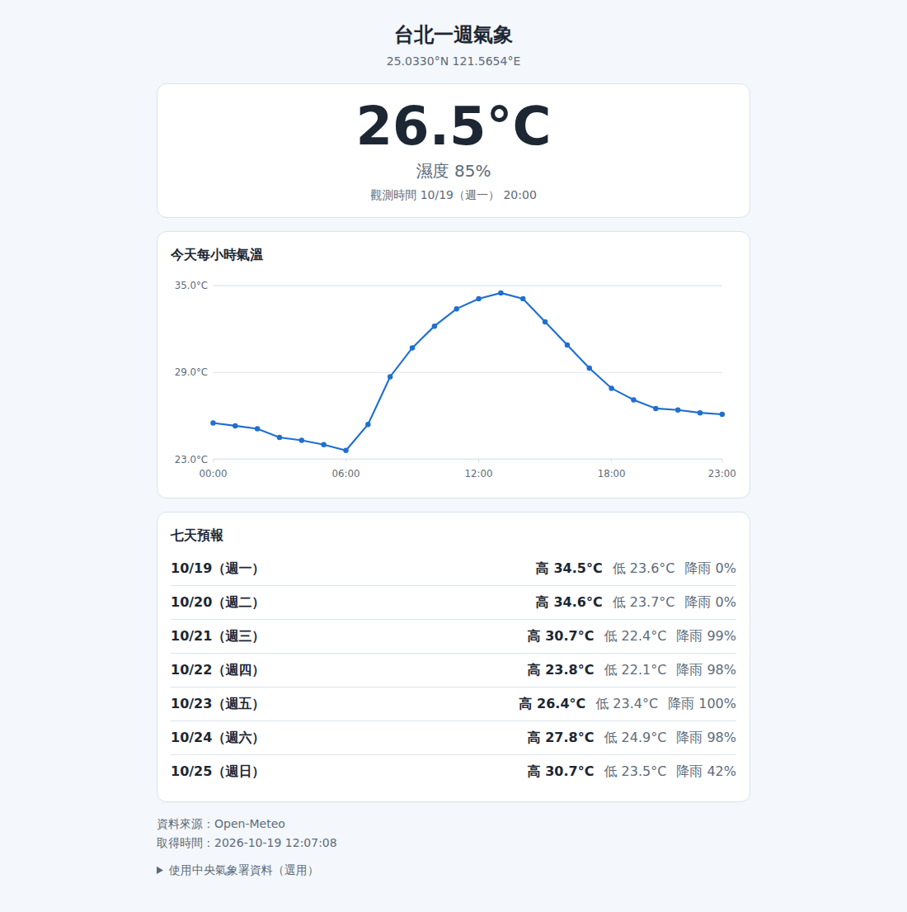 |
| 錄製回應，2026-10-19 10:10 UTC 錄的（步驟 93） | 顯示 27.9°C、75%，與錄製內容一致 | 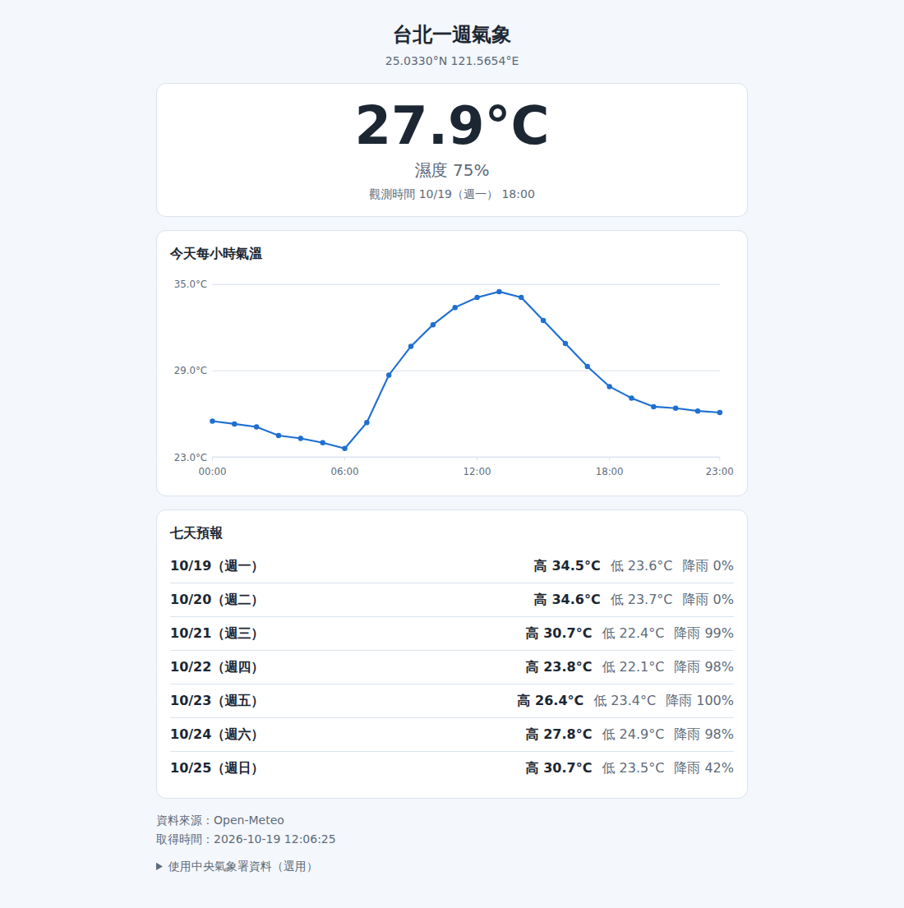 |
| Open-Meteo 回 500（步驟 94） | 「無法取得資料。來源：Open-Meteo；原因：回應狀態 500」，沒有顯示任何數字 | 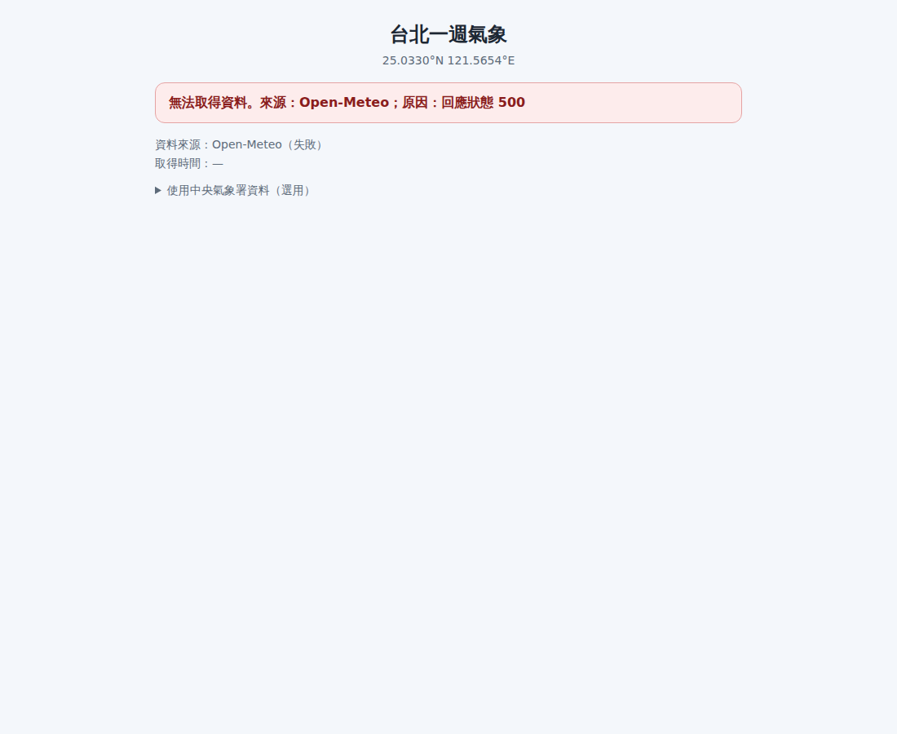 |

**附註**：
- **真實連線的取得方式**：這個容器裡的 Chromium 不信任 session 代理的 CA，直連會得到 `ERR_CERT_AUTHORITY_INVALID`。我沒有關閉 TLS 驗證，而是由驗證腳本改用 urllib 轉送頁面自己發出的同一個請求。urllib 會用 session 的 CA bundle 驗證 TLS，取回的是即時的真實回應（見 `page_check.py`）。
- **頁面小瑕疵**：「取得時間」用瀏覽器的時區顯示，又沒有標出時區，所以在 UTC 的瀏覽器裡顯示成 12:07:08，而「觀測時間」是台北時間 20:00。這是模型建出的頁面的問題，不是 runner 的問題。不過整體審查和 QA 都沒有抓到，見第 4 節第 7 項。
- **中央氣象署（CWA）這條路徑沒有驗證**：`CWA_API_KEY` 要到新的 session 才會載入，這個 session 讀不到。`cwa.js` 的欄位對應是模型憑記憶寫的，沒有用真實回應測過。這部分要開新 session，帶授權碼驗證。

## 4. runner 需要改進或修正的地方

以下都是這次四個 run 實際遇到的問題，依影響大小排列。這個 CHG 沒有改動 `src/`，每一項都要另開 CHG。

1. **節點的權限邊界只看指令，不看節點種類（Run 1）。**
   - **現象**：`runner.yaml` 的同一個指令套用到每個節點，指令有寫檔權限，結果規劃節點 `lead_assess` 和閘門 `pm_signoff` 自己把十個檔案都寫完了，模組迴圈一次都沒跑。
   - **建議**：runner 依節點種類給預設權限：審查、閘門、規劃節點唯讀，只有建置節點可寫。或者至少在啟動時，對「每個節點都有寫檔權限」發出警告。
2. **跟隨型節點（`follows`）不能另外指定模型（Run 2 修正時發現）。**
   - **現象**：`engineer_selfverify` 和 `fix_pass` 一定沿用 `engineer_build` 的模型和指令（`engine._followed_model`），所以自我檢查節點也拿到了寫檔權限。這次靠規格文字和 `measure.py` 的寫檔核對補上。
   - **建議**：讓 `follows` 節點可以只覆寫權限，或指定自己的模型。
3. **plan 裡每個節點共用同一份整體規格，真實模型會照字面執行（Run 3）。**
   - **現象**：`pm_signoff` 是建置前的計畫簽核，卻拿「十個檔案都存在」這條整體驗收條件來判斷，連續兩次否決，流程卡在 `pm_plan → pm_signoff` 迴圈。weather-spa 用腳本代理，從不讀規格，所以這個問題一直沒浮現。
   - **建議**：runner 在每個節點的工作單裡自動帶入「這個節點在流程中的位置與職責」，plan 的規格驗證也要檢查各階段的驗收條件和階段相符。
4. **節點看不到前一個節點的答覆（Run 3）。**
   - **現象**：`pm_signoff` 說「沒有附上 lead assessment」，runner 確實不會把前一個節點的答覆放進工作單。
   - **建議**：簽核、審查類節點應該拿得到它要簽核的那份答覆，否則只能重新評估一次。
5. **沒有進展的迴圈要到 200 步才會停（Run 3）。**
   - **現象**：同一個閘門用同樣的理由一再否決，流程只會繞圈。
   - **建議**：偵測到「同一節點、同樣結論連續 N 次」時，就停下來問人。
6. **需要人確認的停止點，API 上分辨不出來（Run 2）。**
   - **現象**：一般閘門用 `/run/gate`，unsafe 要用 `/run/proceed`，平局要用 `/run/decide`，補需求要用 `/run/instruct`。外部驅動程式只有在被 409 拒絕後才知道該用哪個。原本的 `drive.py` 收到 409 就結束，連伺服器一起關掉了。
   - **建議**：`GET /run` 直接回傳「這個停止點的種類和要用的路由」，console 也用同一份資料。
7. **已接受的風險每次 run 都會再停一次（Run 2、Run 3）。**
   - **現象**：「CWA 授權碼放在網址查詢參數」是 API 本身的要求，你也已接受，但席位每次都可能再標成 unsafe，停下來等人。這次 Run 2、Run 3 都碰到，Run 4 沒有。
   - **建議**：讓操作員在 brief 或設定裡登記「已接受的風險」，席位據此改列為建置限制，而不是 unsafe。
8. **QA 和整體審查不能實際執行頁面。**
   - **現象**：審查節點只有唯讀工具，沒辦法打開頁面，所以沒抓到「取得時間沒有標時區」這類執行時才看得到的問題。在 Run 1，模型也自己說「沒有 shell 或瀏覽器，沒驗證過」。
   - **建議**：給 QA 節點一個受限的執行或瀏覽器檢查能力。也可以由 runner 提供一個無網路的測試步驟。
9. **console 在執行過程中的顯示。**
   - **現象**：頂端狀態列和 ask 數只在 run 停下時更新（`server.py` 的 `_publish` 只在狀態轉換時推送），`GET /run` 的 `at` 也是。只有用量區的 ask 數會即時跳動。從 console 看不出現在跑到哪個節點。
   - **建議**：每次 ask 開始和結束都推送一次事件。
10. **run id 是 ask journal 的路徑，不是短 id。**
    - **建議**：給每個 run 一個短 id，報告、console 和 API 都用同一個。
11. **claude 後端沒有回報用量時，什麼提示都沒有。**
    - **現象**：`claude -p` 沒加 `--output-format json` 時不會印出用量。runner 只在 console 寫一行「not reported」，所以四次 run 的花費都沒留下紀錄。
    - **建議**：runner 遇到已知能回報用量、卻沒開啟的指令時，在啟動時發出警告，或自動補上這個旗標。
12. **流程中有可以省掉的 ask。**
    - **現象**：
      - `engineer_selfverify` 佔 Run 4 的 18%，緊接著的 `lead_task_review` 做的是同類檢查，而這次 selfverify 沒有改動任何檔案。
      - `pr`（12.7 秒）和 `merge`（31.9 秒）是機械性步驟，卻也各問了一次模型。
    - **建議**：讓 plan 可以合併或略過 selfverify，並讓機械性節點不經過模型。

## 5. 四次 run 的經過

| Run | 時間（UTC） | 結果 | 原因與處理 |
|---|---|---|---|
| 1 | 10:37–10:42 | 手動中止，8 次 ask | 所有節點都有寫檔權限。`lead_assess` 回報自己寫好了十個檔案；從檔案最後寫入時間看，`pm_signoff` 最後寫了其中 5 個，第一次 `engineer_selfverify` 最後寫了另外 5 個（步驟 14）。改成預設唯讀、只有建置節點可寫（你選的） |
| 2 | 11:17–11:18 | `drive.py` 結束 | risk 席位標 unsafe，`drive.py` 當成一般閘門處理被拒。改成每次停下都問你（你選的） |
| 3 | 11:32–11:41 | 手動中止 | unsafe 停止點問你，你回「繼續」；之後 `pm_signoff` 用整體驗收條件否決計畫，進入迴圈。改成各節點依階段給規格 |
| 4 | 11:50–12:04 | **完整跑完**，`done` | 量測用 |

Run 1–3 的工作目錄保留在 session 暫存區裡，不進 repository。它們的截圖和文字紀錄在 `steps/`。

## 6. 沒有做到、或和提案不同的地方

- **錄影**：CHG 第 5 項寫了「整段 run 的 console 錄影」，這次**沒有做**。即時畫面改用每 45–60 秒或換節點時的截圖，同步推送到即時頁面，這些截圖都收在 `steps/` 的 20、40、60、80 組。
- **只跑了一次**：量測用的完整 run 只有 Run 4 一次。
- **CWA**：沒有用真實授權碼驗證。
- **花費與速率限制**：都沒有量測，見第 1 節。
- **Run 3 的執行指令沒有在當下擷取**：擷取用的包裝程式和 run 一起被結束了。Run 3 的執行紀錄、交給你閱讀的停止全文、你的回覆，以及這兩個檔案的寫入時間，事後從保留的工作目錄補擷取，見步驟 52、56、57、58。
- **停止點的範圍**：「每次停下都問我」，你在 2026-10-20 確認是指需要人閱讀的停止點。plan 裡的一般閘門（例如 Run 4 的 merge）仍由 `drive.py` 代為核准。
- **驗證腳本**：`page_check.py` 由 orchestrator 撰寫，不是 coder，因為它只是驗證步驟用的程式。內容在步驟 91，有完整截圖。
- **Run 1 的 `drive.py` 狀態**：Run 1 跑的時候還沒有「停下問人」的處理，Run 2 之後才加上。

## 7. 重跑方式

1. 環境要求：
   - 允許連線到 `api.open-meteo.com`；
   - 安裝 `claude` CLI，並能使用 `claude-sonnet-5-5`；
   - Python 3.9 以上；
   - 有 Chromium 和 Playwright，截圖時才需要。
2. `python3 examples/weather-live/drive.py --dry-run`：確認設定可以被載入。
3. `PYTHONPATH=src python3 examples/weather-live/drive.py --workdir RUN --start-when RUN-go`：啟動 runner serve，並等待開始訊號。
4. 依需要擷取 console 和設定（`capture.py page` / `cmd` / `file`），然後 `touch RUN-go` 開始 run。也可以另開 `capture.py watch` 定時擷取 console。
5. 出現 `AWAITING-PERSON <檔案>` 時，閱讀該檔案，再建立同名的 `.proceed` 或 `.stop` 檔回覆。
6. 跑完後執行 `measure.py RUN --json OUT --drive-log <drive 的輸出>` 算出數字，再執行 `page_check.py RUN/site <fixture> <輸出目錄> live|recorded|failing` 驗證頁面。

## 8. 操作流程（每一步的指令或設定、截圖與 UTC 時間）

### Run 1：設定、執行與中止

- **步驟 1 · repo-state** — 記錄實測所用的程式版本（分支與 commit）  
  指令：`git log -1 '--format=%H %s'`  
  10:36:04 → 10:36:04 UTC · 文字紀錄 [01-repo-state.txt](steps/01-repo-state.txt)  
  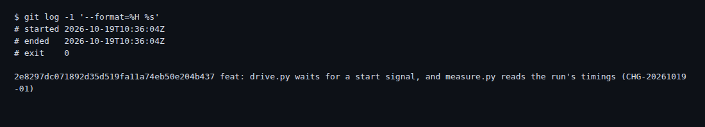

- **步驟 2 · tool-versions** — 記錄 Python、runner（pyproject 版本）與 claude CLI 的版本  
  指令：`python3 --version; grep -m1 '^version' pyproject.toml; PYTHONPATH=src python3 -m ai_sdlc_runner.cli --help | head -2; claude --version`  
  10:36:27 → 10:36:27 UTC · 文字紀錄 [02-tool-versions.txt](steps/02-tool-versions.txt)  
  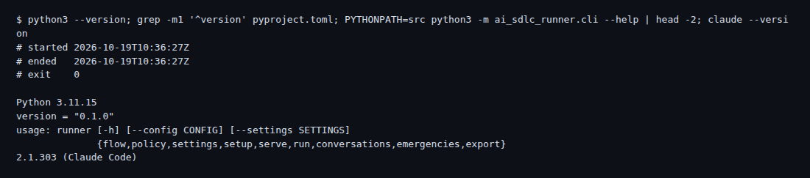

- **步驟 3 · backend-probe** — 確認真實後端 claude-sonnet-5-5（effort medium）可回應  
  指令：`echo 'Reply OK' | $S/cleanenv.sh claude -p --model claude-sonnet-5-5 --effort medium --tools '' --output-format json | python3 -c 'import json,sys;d=json.load(sys.stdin);print("result:",d["result"]);print("is_error:",d["is_error"]);print("model:",list(d.get("modelUsage",{})))'`  
  10:36:06 → 10:36:09 UTC · 文字紀錄 [03-backend-probe.txt](steps/03-backend-probe.txt)  
  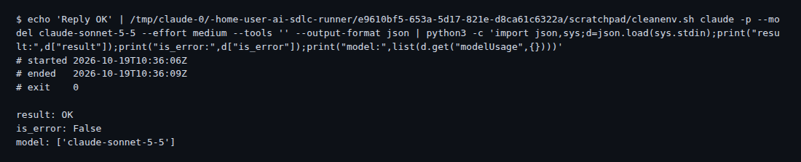

- **步驟 4 · drive-dry-run** — 驗證 plan、runner.yaml 與 brief 可被 runner 載入，未啟動 run  
  指令：`python3 examples/weather-live/drive.py --dry-run`  
  10:36:10 → 10:36:10 UTC · 文字紀錄 [04-drive-dry-run.txt](steps/04-drive-dry-run.txt)  
  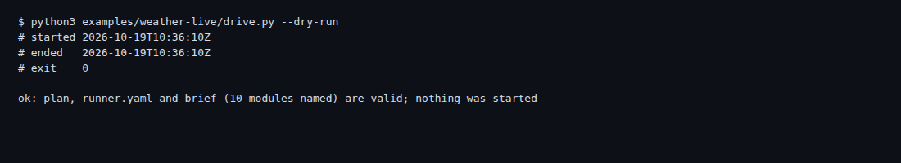

- **步驟 5 · runner-yaml** — 設定：真實後端的指令、權限與逾時  
  檔案：`examples/weather-live/runner.yaml`（sha256 `6b1a00f74521…`）  
  10:36:11 → 10:36:12 UTC · 文字紀錄 [05-runner-yaml.txt](steps/05-runner-yaml.txt)  
  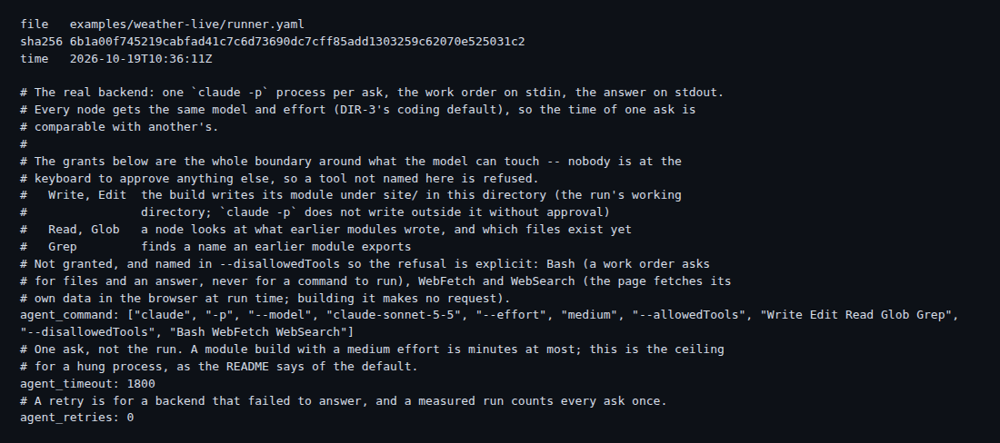

- **步驟 6 · brief** — 設定：交給 runner 的需求（brief）  
  檔案：`examples/weather-live/brief.md`（sha256 `52f008926524…`）  
  10:36:12 → 10:36:13 UTC · 文字紀錄 [06-brief.txt](steps/06-brief.txt)  
  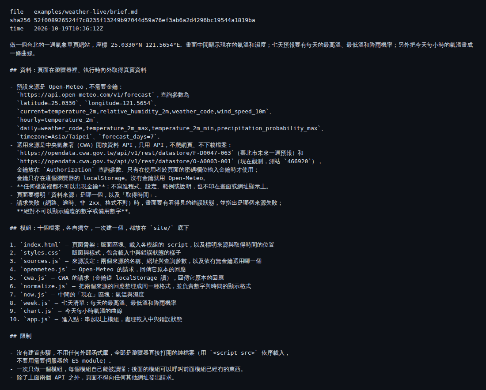

- **步驟 7 · plan** — 設定：runner serve 使用的 plan（24 個節點規格）  
  檔案：`examples/weather-live/plan.json`（sha256 `377eb2765d0e…`）  
  10:36:13 → 10:36:15 UTC · 文字紀錄 [07-plan.txt](steps/07-plan.txt)  
  

- **步驟 8 · run** — 以真實後端執行 runner：啟動 runner serve、等待開始訊號後輸入 brief、開始 run、核准閘門直到結束（結束碼 143）  
  指令：`PYTHONPATH=src $S/cleanenv.sh python3 -u examples/weather-live/drive.py --workdir $S/run1 --start-when $S/run1-go`  
  10:36:36 → 10:41:58 UTC · 文字紀錄 [08-run.txt](steps/08-run.txt)  
  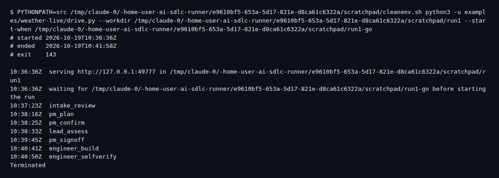

- **步驟 10 · models** — 設定：模型註冊表（GET /models）  
  指令：`curl -sS -H @$HDR http://127.0.0.1:49777/models | python3 -m json.tool`  
  10:37:02 → 10:37:02 UTC · 文字紀錄 [10-models.txt](steps/10-models.txt)  
  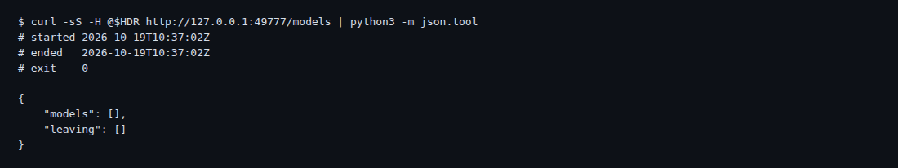

- **步驟 11 · node-assignments** — 設定：節點的模型指派（GET /config/nodes）  
  指令：`curl -sS -H @$HDR http://127.0.0.1:49777/config/nodes | python3 -m json.tool`  
  10:37:03 → 10:37:03 UTC · 文字紀錄 [11-node-assignments.txt](steps/11-node-assignments.txt)  
  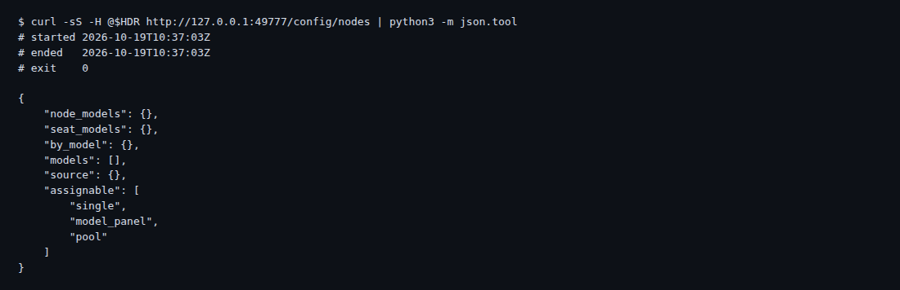

- **步驟 12 · seats** — 設定：審議席位（GET /config/seats）  
  指令：`curl -sS -H @$HDR http://127.0.0.1:49777/config/seats | python3 -m json.tool`  
  10:37:04 → 10:37:04 UTC · 文字紀錄 [12-seats.txt](steps/12-seats.txt)  
  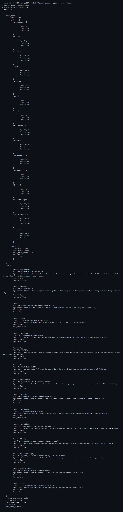

- **步驟 14 · site-files-at-abort** — 記錄十個檔案的寫入時間，對照各節點 ask 的時間  
  指令：`ls -la --time-style=+%H:%M:%S $S/run1/site; ls -la --time-style=+%H:%M:%S $S/run1/.runner/asks`  
  10:41:57 → 10:41:57 UTC · 文字紀錄 [14-site-files-at-abort.txt](steps/14-site-files-at-abort.txt)  
  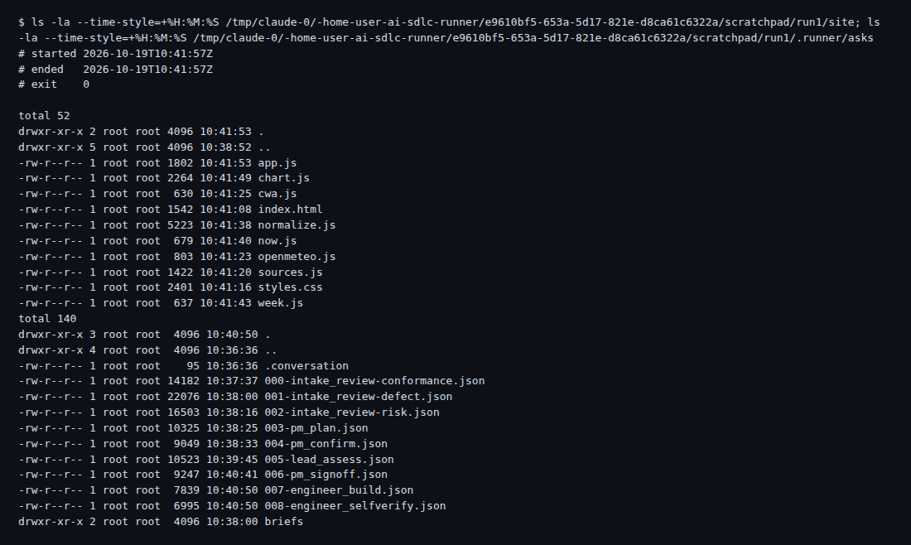

**執行中的 console**：每 45–60 秒或換節點時自動擷取，共 8 張。

- 10:36:49 UTC · [09-console-before-run.txt](steps/09-console-before-run.txt)  
  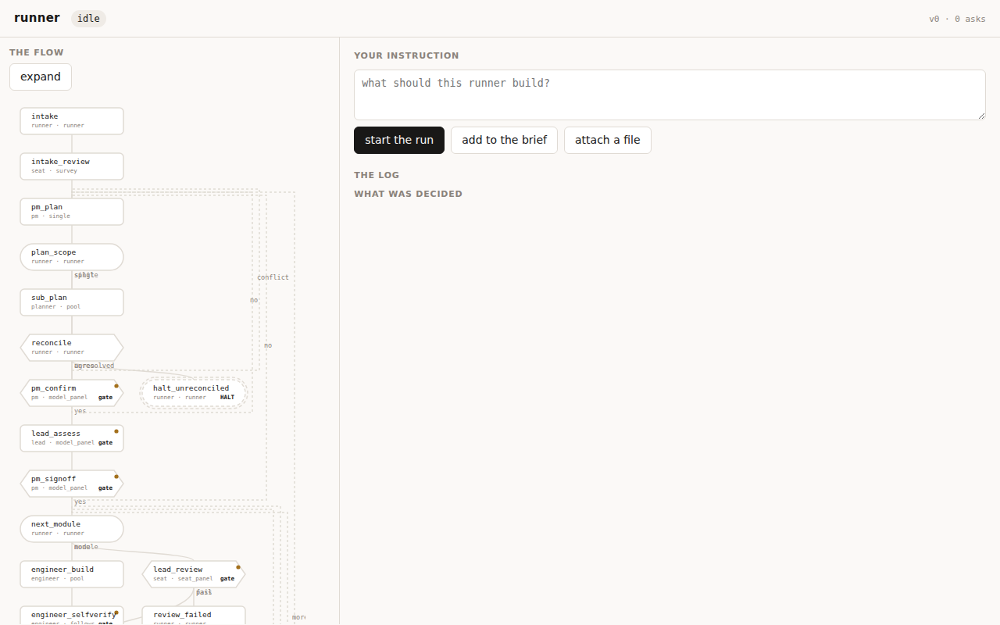
- 10:41:56 UTC · [13-console-at-abort.txt](steps/13-console-at-abort.txt)  
  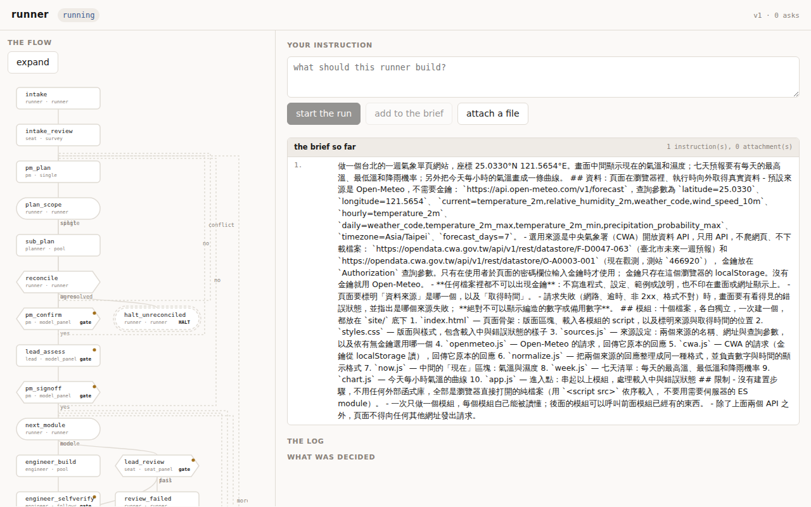
- 10:37:17 UTC · [20-console-none-103717-001.txt](steps/20-console-none-103717-001.txt)  
  
- 10:38:05 UTC · [20-console-none-103805-002.txt](steps/20-console-none-103805-002.txt)  
  
- 10:38:52 UTC · [20-console-none-103852-003.txt](steps/20-console-none-103852-003.txt)  
  
- 10:39:40 UTC · [20-console-none-103940-004.txt](steps/20-console-none-103940-004.txt)  
  
- 10:40:27 UTC · [20-console-none-104027-005.txt](steps/20-console-none-104027-005.txt)  
  
- 10:41:15 UTC · [20-console-none-104115-006.txt](steps/20-console-none-104115-006.txt)  
  

### Run 2：只給建置節點寫檔後重跑，停在 unsafe 停止點

- **步驟 30 · run2-repo-state** — Run 2：記錄修正後的程式版本  
  指令：`git log -1 '--format=%H %s'`  
  11:16:34 → 11:16:34 UTC · 文字紀錄 [30-run2-repo-state.txt](steps/30-run2-repo-state.txt)  
  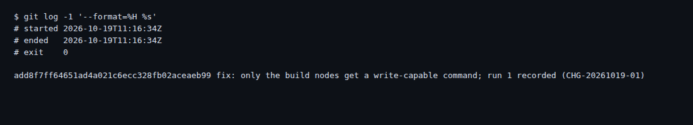

- **步驟 31 · run2-drive-dry-run** — Run 2：驗證 plan、runner.yaml、models.json 與 brief 可被 runner 載入  
  指令：`python3 examples/weather-live/drive.py --dry-run`  
  11:16:35 → 11:16:35 UTC · 文字紀錄 [31-run2-drive-dry-run.txt](steps/31-run2-drive-dry-run.txt)  
  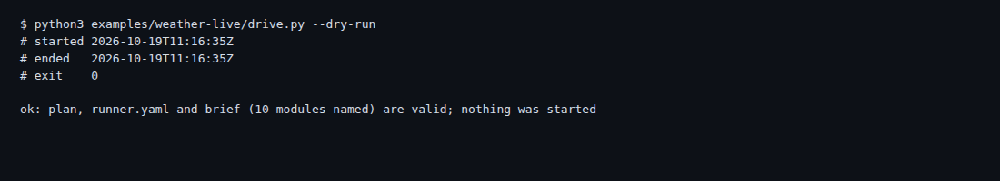

- **步驟 32 · run2-runner-yaml** — 設定：預設指令改為唯讀（Read Glob Grep）  
  檔案：`examples/weather-live/runner.yaml`（sha256 `8304d892450a…`）  
  11:16:36 → 11:16:37 UTC · 文字紀錄 [32-run2-runner-yaml.txt](steps/32-run2-runner-yaml.txt)  
  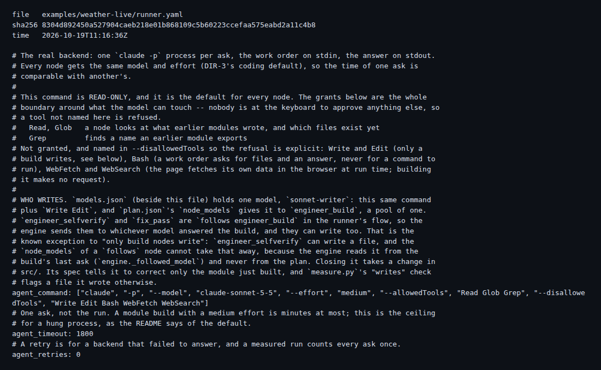

- **步驟 33 · run2-models-json** — 設定：可寫檔的 sonnet-writer，只指派給 engineer_build  
  檔案：`examples/weather-live/models.json`（sha256 `3ff9bc7305d9…`）  
  11:16:37 → 11:16:38 UTC · 文字紀錄 [33-run2-models-json.txt](steps/33-run2-models-json.txt)  
  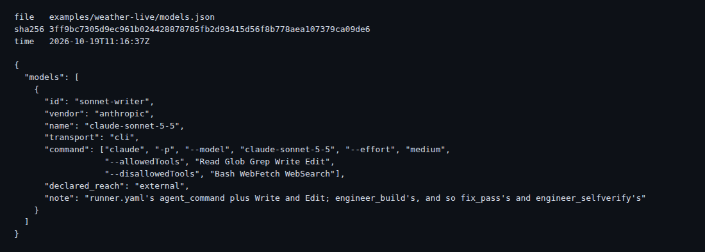

- **步驟 34 · run2-plan** — 設定：plan 的 node_models 與各節點規格  
  檔案：`examples/weather-live/plan.json`（sha256 `76631e49e3c4…`）  
  11:16:38 → 11:16:42 UTC · 文字紀錄 [34-run2-plan.txt](steps/34-run2-plan.txt)  
  

- **步驟 35 · run2** — Run 2：以修正後的設定執行 runner：啟動 runner serve、等待開始訊號後輸入 brief、開始 run、核准閘門直到結束（結束碼 1；擷取內容有遮蔽）  
  指令：`PYTHONPATH=src $S/cleanenv.sh python3 -u examples/weather-live/drive.py --workdir $S/run2 --start-when $S/run2-go`  
  11:16:46 → 11:18:21 UTC · 文字紀錄 [35-run2.txt](steps/35-run2.txt)  
  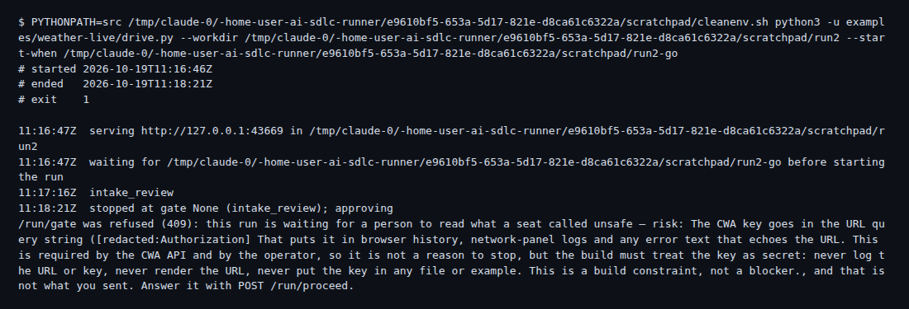

- **步驟 36 · run2-console-before-run** — Run 2：run 開始前的 runner console  
  畫面：runner console（Chromium 擷取；operator token 只在網址片段裡，不進截圖或文字檔）  
  11:16:54 → 11:16:56 UTC · 文字紀錄 [36-run2-console-before-run.txt](steps/36-run2-console-before-run.txt)  
  

- **步驟 37 · run2-models** — 設定：模型註冊表，含 sonnet-writer（GET /models）  
  指令：`curl -sS -H @$HDR http://127.0.0.1:43669/models | python3 -m json.tool`  
  11:16:56 → 11:16:56 UTC · 文字紀錄 [37-run2-models.txt](steps/37-run2-models.txt)  
  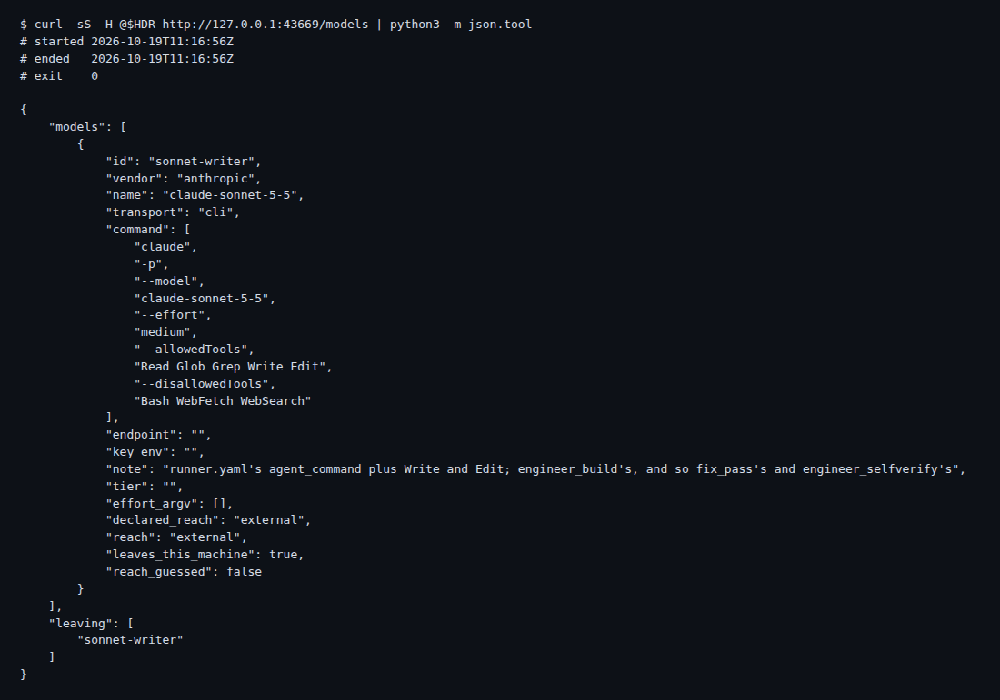

- **步驟 38 · run2-node-assignments** — 設定：engineer_build 指派 sonnet-writer（GET /config/nodes）  
  指令：`curl -sS -H @$HDR http://127.0.0.1:43669/config/nodes | python3 -m json.tool`  
  11:16:57 → 11:16:57 UTC · 文字紀錄 [38-run2-node-assignments.txt](steps/38-run2-node-assignments.txt)  
  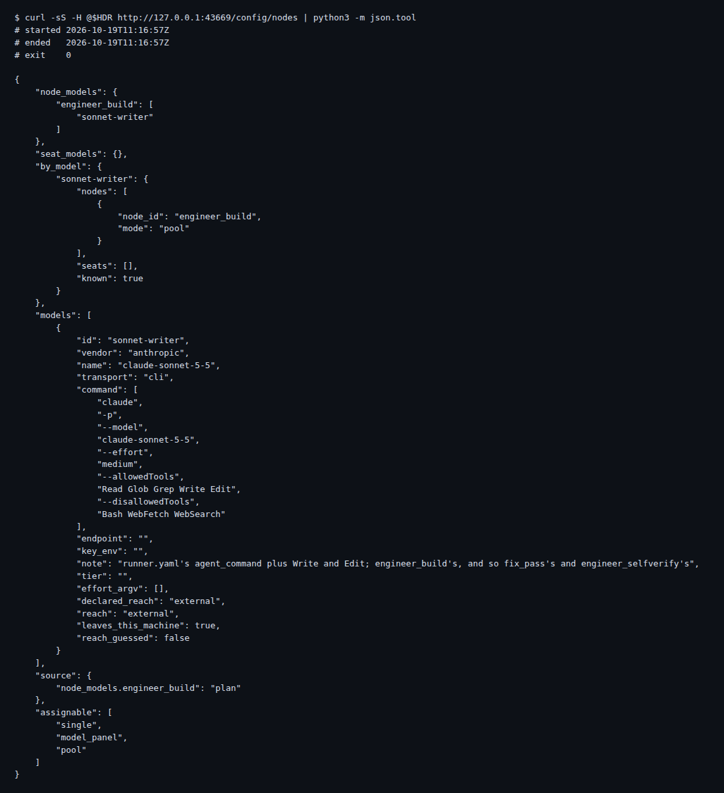

**執行中的 console**：每 45–60 秒或換節點時自動擷取，共 2 張。

- 11:17:05 UTC · [40-console-none-111705-001.txt](steps/40-console-none-111705-001.txt)  
  
- 11:18:07 UTC · [40-console-none-111807-002.txt](steps/40-console-none-111807-002.txt)  
  

### Run 3：停下問人後繼續，停在規劃迴圈

- **步驟 50 · run3-repo-state** — Run 3：記錄程式版本（加入停下問人）  
  指令：`git log -1 '--format=%H %s'`  
  11:31:47 → 11:31:47 UTC · 文字紀錄 [50-run3-repo-state.txt](steps/50-run3-repo-state.txt)  
  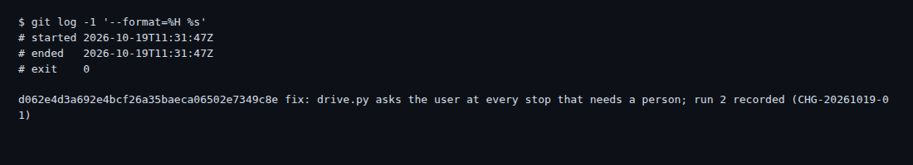

- **步驟 51 · run3-drive-dry-run** — Run 3：驗證設定可被 runner 載入  
  指令：`python3 examples/weather-live/drive.py --dry-run`  
  11:31:48 → 11:31:48 UTC · 文字紀錄 [51-run3-drive-dry-run.txt](steps/51-run3-drive-dry-run.txt)  
  

- **步驟 52 · run3-drive-log** — Run 3 的執行輸出（drive.py 的完整紀錄）。原本的擷取包裝在中止 run 時被一併結束，沒有寫出；這是事後從保留的紀錄檔擷取  
  檔案：`$S/run3.log`（sha256 `1ca37d8a8a31…`）  
  11:56:55 → 11:57:21 UTC · 文字紀錄 [52-run3-drive-log.txt](steps/52-run3-drive-log.txt)  
  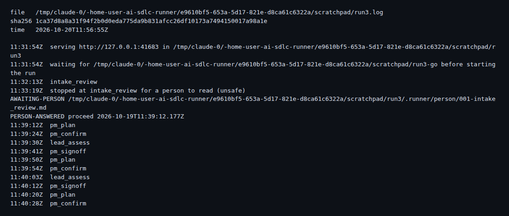

- **步驟 53 · run3-console-before-run** — Run 3：run 開始前的 runner console  
  畫面：runner console（Chromium 擷取；operator token 只在網址片段裡，不進截圖或文字檔）  
  11:31:59 → 11:32:00 UTC · 文字紀錄 [53-run3-console-before-run.txt](steps/53-run3-console-before-run.txt)  
  

- **步驟 54 · run3-console-at-abort** — Run 3 中止前的 console：pm_signoff 兩次以「site/ 尚無檔案」否決，流程在 pm_plan→pm_signoff 之間循環（擷取內容有遮蔽）  
  畫面：runner console（Chromium 擷取；operator token 只在網址片段裡，不進截圖或文字檔）  
  11:40:30 → 11:40:32 UTC · 文字紀錄 [54-run3-console-at-abort.txt](steps/54-run3-console-at-abort.txt)  
  

- **步驟 55 · run3-signoff-verdicts** — Run 3：兩次 pm_signoff 的答覆原文  
  指令：`cd $S/run3/.runner/asks && for f in *pm_signoff*.json; do echo "== $f"; python3 -c "import json,sys;print(json.load(open(sys.argv[1]))['result']['stdout'])" $f; done`  
  11:40:32 → 11:40:32 UTC · 文字紀錄 [55-run3-signoff-verdicts.txt](steps/55-run3-signoff-verdicts.txt)  
  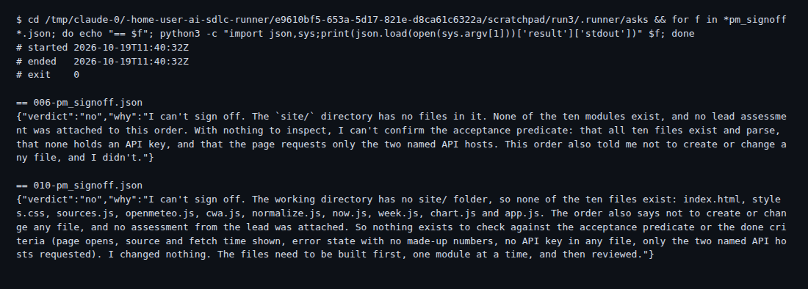

- **步驟 56 · run3-person-stop** — Run 3：intake_review 停下時交給使用者閱讀的全文（事後擷取）（擷取內容有遮蔽）  
  檔案：`$S/run3/.runner/person/001-intake_review.md`（sha256 `81eb23b21c88…`）  
  11:57:21 → 11:57:23 UTC · 文字紀錄 [56-run3-person-stop.txt](steps/56-run3-person-stop.txt)  
  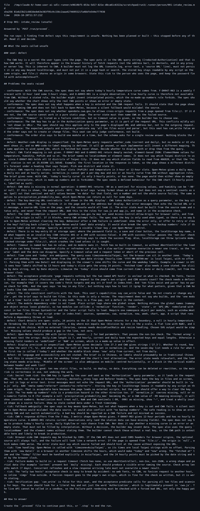

- **步驟 57 · run3-person-answer** — Run 3：使用者的回覆「繼續」，11:39:12 UTC 寫入（事後擷取；檔案時間見文字紀錄）  
  檔案：`$S/run3/.runner/person/001-intake_review.proceed`（sha256 `8e0adec90d6e…`）  
  11:57:23 → 11:57:25 UTC · 文字紀錄 [57-run3-person-answer.txt](steps/57-run3-person-answer.txt)  
  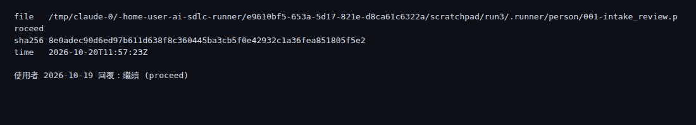

- **步驟 58 · run3-person-file-times** — Run 3：停止檔與回覆檔的寫入時間（UTC），佐證 11:33:19 停下、11:39:12 回覆  
  指令：`TZ=UTC ls -la --time-style=+%FT%TZ $S/run3/.runner/person/`  
  11:57:34 → 11:57:34 UTC · 文字紀錄 [58-run3-person-file-times.txt](steps/58-run3-person-file-times.txt)  
  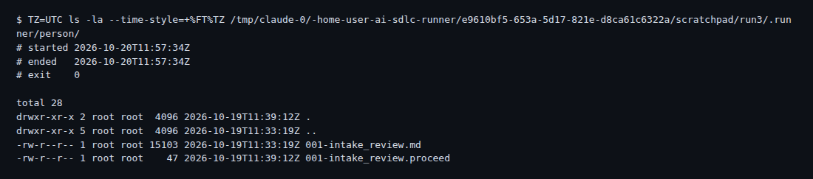

**執行中的 console**：每 45–60 秒或換節點時自動擷取，共 10 張。

- 11:33:21 UTC · [60-console-intake_review-113321-003.txt](steps/60-console-intake_review-113321-003.txt)  
  
- 11:34:22 UTC · [60-console-intake_review-113422-004.txt](steps/60-console-intake_review-113422-004.txt)  
  
- 11:35:24 UTC · [60-console-intake_review-113524-005.txt](steps/60-console-intake_review-113524-005.txt)  
  
- 11:36:26 UTC · [60-console-intake_review-113626-006.txt](steps/60-console-intake_review-113626-006.txt)  
  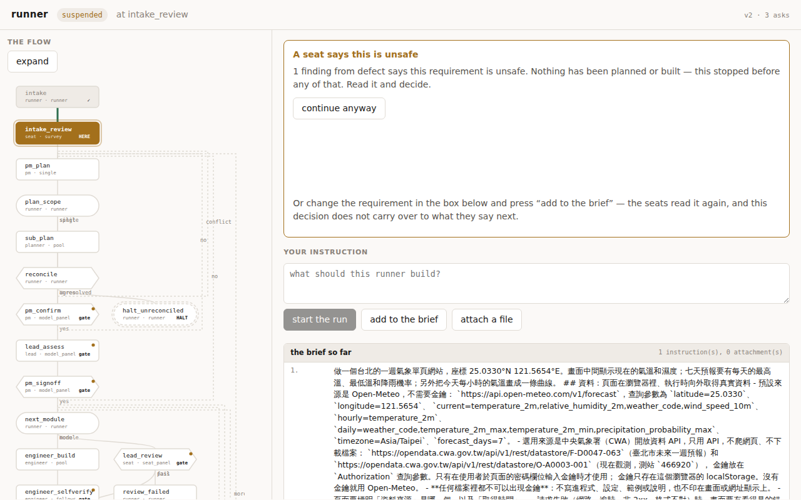
- 11:37:27 UTC · [60-console-intake_review-113727-007.txt](steps/60-console-intake_review-113727-007.txt)  
  
- 11:38:29 UTC · [60-console-intake_review-113829-008.txt](steps/60-console-intake_review-113829-008.txt)  
  
- 11:39:30 UTC · [60-console-intake_review-113930-009.txt](steps/60-console-intake_review-113930-009.txt)  
  
- 11:40:32 UTC · [60-console-intake_review-114032-010.txt](steps/60-console-intake_review-114032-010.txt)  
  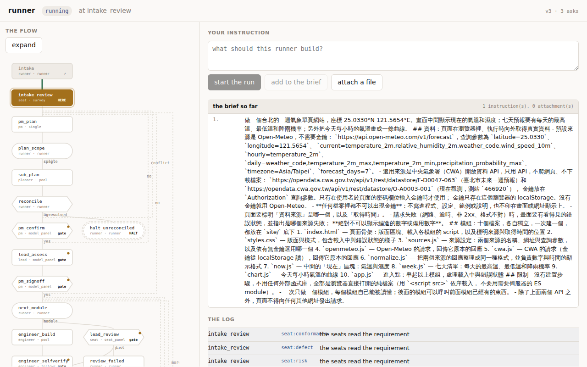
- 11:32:08 UTC · [60-console-none-113207-001.txt](steps/60-console-none-113207-001.txt)  
  
- 11:33:09 UTC · [60-console-none-113309-002.txt](steps/60-console-none-113309-002.txt)  
  

### Run 4：各節點依階段的規格，完整跑完（量測用）

- **步驟 70 · run4-repo-state** — Run 4：記錄程式版本（各節點依階段的規格）  
  指令：`git log -1 '--format=%H %s'`  
  11:50:13 → 11:50:13 UTC · 文字紀錄 [70-run4-repo-state.txt](steps/70-run4-repo-state.txt)  
  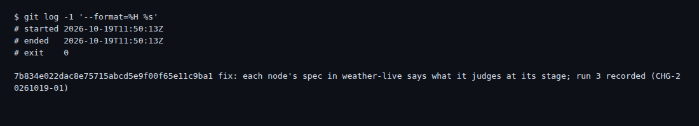

- **步驟 71 · run4-drive-dry-run** — Run 4：驗證設定可被 runner 載入  
  指令：`python3 examples/weather-live/drive.py --dry-run`  
  11:50:15 → 11:50:15 UTC · 文字紀錄 [71-run4-drive-dry-run.txt](steps/71-run4-drive-dry-run.txt)  
  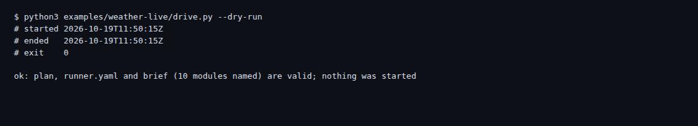

- **步驟 72 · run4-plan** — 設定：各節點依階段的規格  
  檔案：`examples/weather-live/plan.json`（sha256 `221b59701398…`）  
  11:50:16 → 11:50:18 UTC · 文字紀錄 [72-run4-plan.txt](steps/72-run4-plan.txt)  
  

- **步驟 73 · run4** — Run 4：執行 runner；需要人員確認的停止點交由使用者決定  
  指令：`PYTHONPATH=src $S/cleanenv.sh python3 -u examples/weather-live/drive.py --workdir $S/run4 --start-when $S/run4-go`  
  11:50:23 → 12:04:23 UTC · 文字紀錄 [73-run4.txt](steps/73-run4.txt)  
  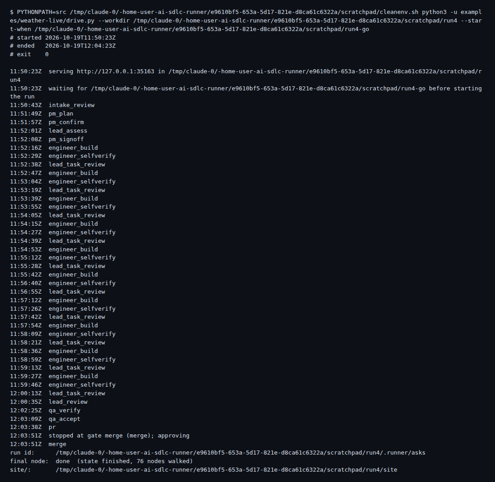

- **步驟 74 · run4-console-before-run** — Run 4：run 開始前的 runner console  
  畫面：runner console（Chromium 擷取；operator token 只在網址片段裡，不進截圖或文字檔）  
  11:50:27 → 11:50:29 UTC · 文字紀錄 [74-run4-console-before-run.txt](steps/74-run4-console-before-run.txt)  
  

**執行中的 console**：每 45–60 秒或換節點時自動擷取，共 14 張。

- 12:03:51 UTC · [80-console-merge-120351-014.txt](steps/80-console-merge-120351-014.txt)  
  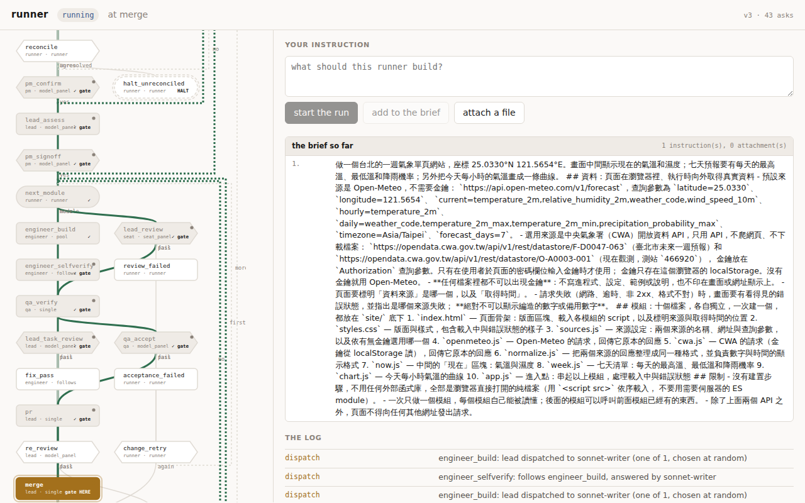
- 11:50:36 UTC · [80-console-none-115036-001.txt](steps/80-console-none-115036-001.txt)  
  
- 11:51:38 UTC · [80-console-none-115138-002.txt](steps/80-console-none-115138-002.txt)  
  
- 11:52:39 UTC · [80-console-none-115239-003.txt](steps/80-console-none-115239-003.txt)  
  
- 11:53:41 UTC · [80-console-none-115341-004.txt](steps/80-console-none-115341-004.txt)  
  
- 11:54:42 UTC · [80-console-none-115442-005.txt](steps/80-console-none-115442-005.txt)  
  
- 11:55:44 UTC · [80-console-none-115544-006.txt](steps/80-console-none-115544-006.txt)  
  
- 11:56:46 UTC · [80-console-none-115646-007.txt](steps/80-console-none-115646-007.txt)  
  
- 11:57:47 UTC · [80-console-none-115747-008.txt](steps/80-console-none-115747-008.txt)  
  
- 11:58:49 UTC · [80-console-none-115849-009.txt](steps/80-console-none-115849-009.txt)  
  
- 11:59:51 UTC · [80-console-none-115951-010.txt](steps/80-console-none-115951-010.txt)  
  
- 12:00:52 UTC · [80-console-none-120052-011.txt](steps/80-console-none-120052-011.txt)  
  
- 12:01:54 UTC · [80-console-none-120154-012.txt](steps/80-console-none-120154-012.txt)  
  
- 12:02:55 UTC · [80-console-none-120255-013.txt](steps/80-console-none-120255-013.txt)  
  

### Run 4 之後：量測與頁面驗證

- **步驟 90 · run4-measure** — Run 4：從對話紀錄計算耗時、模組迴圈佔比、各節點時間、Amdahl 上限與寫檔歸屬  
  指令：`PYTHONPATH=src python3 docs/measurements/CHG-20261019-01/measure.py $S/run4 --json docs/measurements/CHG-20261019-01/run4-measure.json --drive-log $S/run4.log`  
  12:04:34 → 12:04:34 UTC · 文字紀錄 [90-run4-measure.txt](steps/90-run4-measure.txt)  
  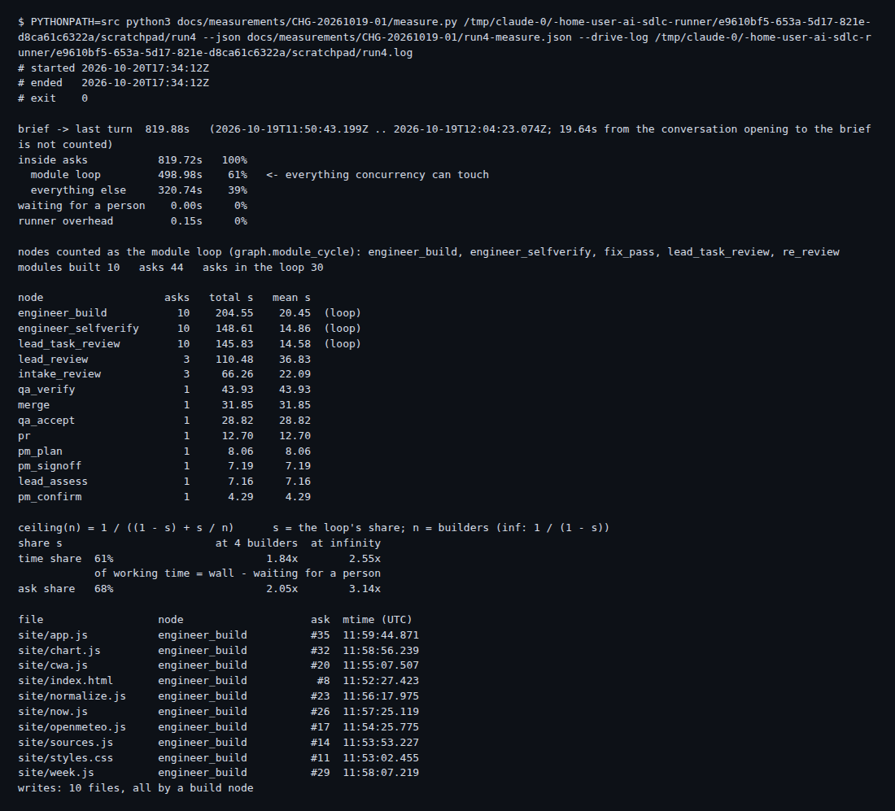

- **步驟 91 · page-check-script** — 驗證用腳本：以 Chromium 三種方式開啟 Run 4 建出的頁面並截圖；live 模式由腳本以驗證 TLS 的 urllib 轉送頁面的真實請求  
  檔案：`$S/verify/page_check.py`（sha256 `4b1e0203be94…`）  
  12:07:04 → 12:07:05 UTC · 文字紀錄 [91-page-check-script.txt](steps/91-page-check-script.txt)  
  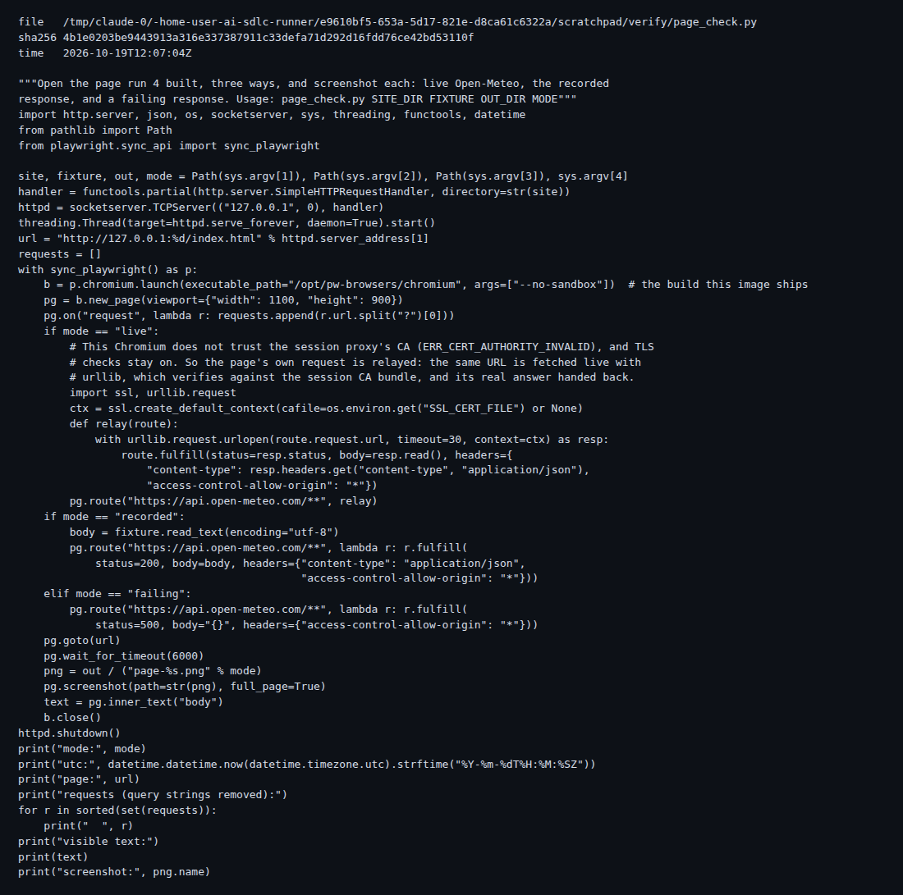

- **步驟 92 · page-live** — 驗證：連真實 Open-Meteo 開啟頁面，確認顯示真實數據、來源與取得時間  
  指令：`python3 $S/verify/page_check.py $S/run4/site examples/weather-live/fixtures/open-meteo-taipei-2026-10-19.json docs/measurements/CHG-20261019-01/steps live`  
  12:07:05 → 12:07:14 UTC · 文字紀錄 [92-page-live.txt](steps/92-page-live.txt)  
  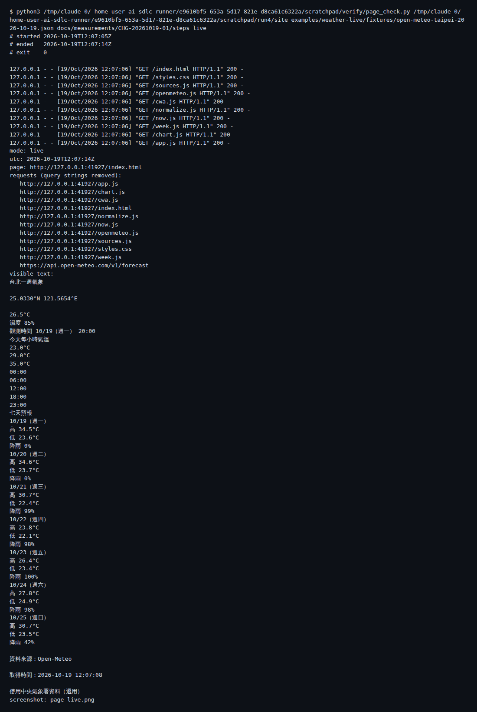

- **步驟 93 · page-recorded** — 驗證：以錄製的  
  指令：`python3 $S/verify/page_check.py $S/run4/site examples/weather-live/fixtures/open-meteo-taipei-2026-10-19.json docs/measurements/CHG-20261019-01/steps recorded`  
  12:06:24 → 12:06:31 UTC · 文字紀錄 [93-page-recorded.txt](steps/93-page-recorded.txt)  
  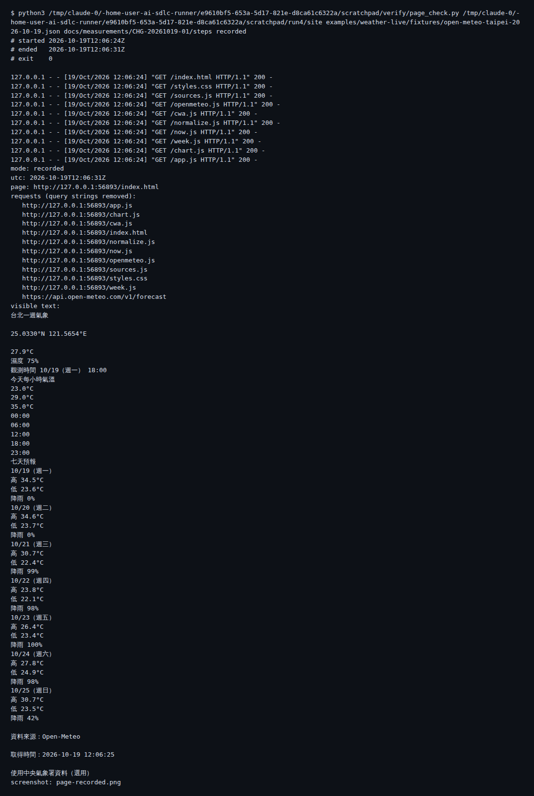

- **步驟 94 · page-failing** — 驗證：Open-Meteo  
  指令：`python3 $S/verify/page_check.py $S/run4/site examples/weather-live/fixtures/open-meteo-taipei-2026-10-19.json docs/measurements/CHG-20261019-01/steps failing`  
  12:06:32 → 12:06:40 UTC · 文字紀錄 [94-page-failing.txt](steps/94-page-failing.txt)  
  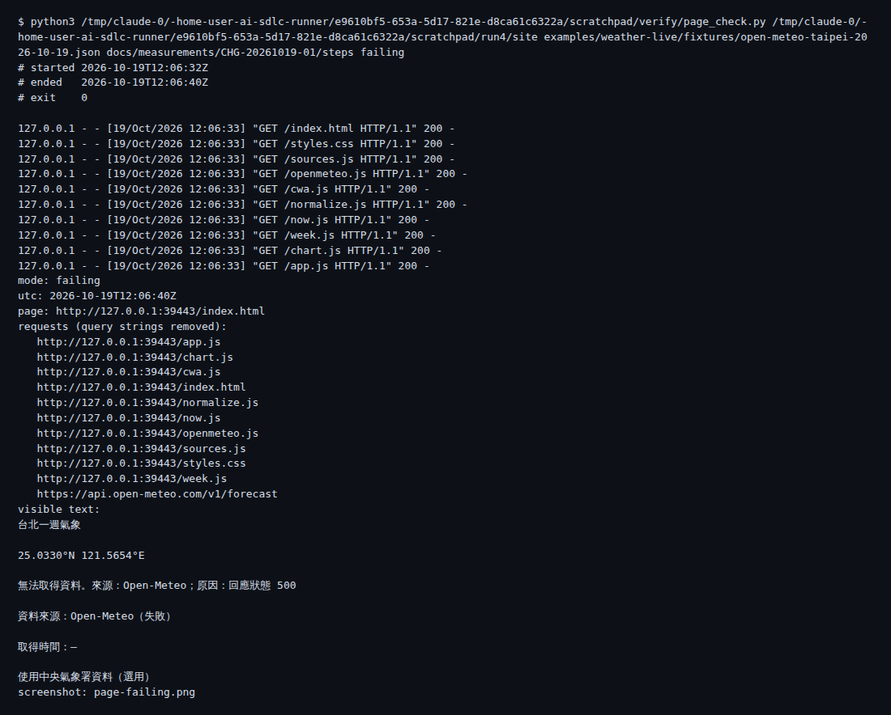

